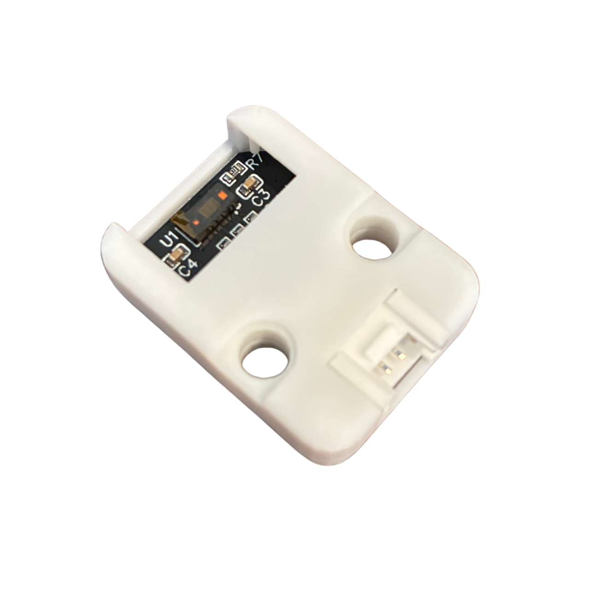
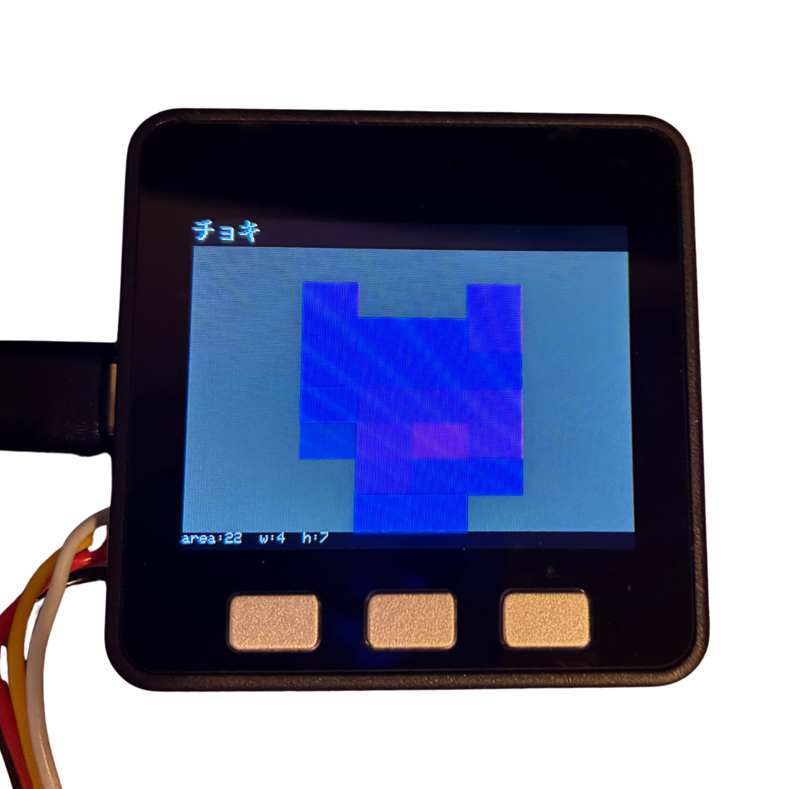

# VL53L5CX Module for M5Stack Unit

VL53L5CX（8x8 ToF距離センサー）をM5Stackで扱いやすくするためのGrove接続モジュールです。

---

## 概要

STMicroelectronics製のVL53L5CX（8x8ゾーンのToF距離センサー）を搭載したユニットで、M5Stackに直接接続して使用できます。  
Grove（I2C）接続により、配線を気にせず距離マップの取得を手軽に実現できます。

---

## 特徴

- Grove（I2C）接続で簡単に利用可能
- 8x8（64ゾーン）の距離マップを取得可能
- M5Stackシリーズに最適化

---

## 必要なもの

- M5Stack本体
- 本モジュール（vl53l5cx-m5-unit）

---

## 接続方法

Groveポート（Port A / I2C）に接続するだけで利用できます。

---

## 想定用途

- 人・物の検知
- 距離マップによる形状把握
- ジェスチャー検出
- 非接触センシング

---

## Examples

本リポジトリにはサンプルを用意しています。

### [Basic](examples/Basic)

VL53L5CXの基本動作確認

- センサー初期化
- 8x8距離マップの取得
- M5StackのLCDへヒートマップ表示

### [HeatmapDisplay](examples/HeatmapDisplay)

8x8距離マップをヒートマップとしてLCDに表示する、他のジェスチャー系サンプルの土台

### [GestureDemo](examples/GestureDemo)

手の重心追跡による上下左右スワイプジェスチャーの認識

### [FingerDirection](examples/FingerDirection)

かざした指がさす8方向（上下左右・斜め）の認識

### [RockPaperScissors](examples/RockPaperScissors)

手の形（グー・チョキ・パー）によるじゃんけんポーズ判定

---

## 購入先

[スイッチサイエンス](https://www.switch-science.com/collections/all/cat:%E3%82%B9%E3%82%A4%E3%83%83%E3%83%81%E3%82%B5%E3%82%A4%E3%82%A8%E3%83%B3%E3%82%B9%E3%83%9E%E3%83%BC%E3%82%B1%E3%83%83%E3%83%88%E3%83%97%E3%83%AC%E3%82%A4%E3%82%B9%EF%BC%88%E5%A7%94%E8%A8%97%E5%95%86%E5%93%81%EF%BC%89_XMAKERS)

[BASE](https://xmakers.base.shop/)

---

## 解説記事（note）

- [距離を「点」ではなく「面」で測るToFユニット](https://note.com/xmakers/n/n0a0d34098ebb)
- [指差しの向きが、64点の距離で分かる。ToFセンサーで8方向を認識してみた](https://note.com/xmakers/n/nb2e458a491fc)

---

## ライセンス

[MIT License](LICENSE)
